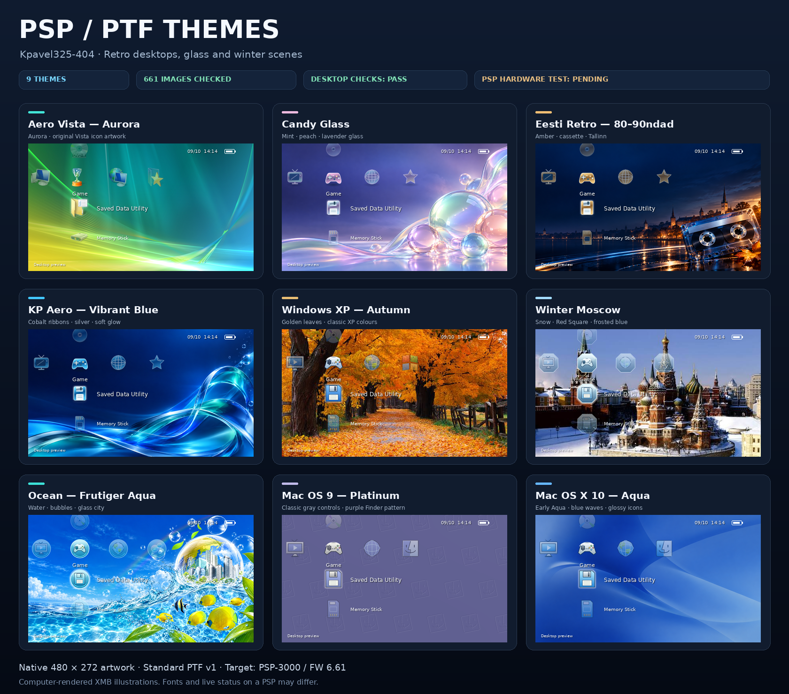

# Темы PTF для PSP — коллекция KP

[English](README.md) · [Установка](docs/INSTALL_RU.md) · [Проверка](docs/VERIFICATION.md) · [Сборка](docs/BUILD.md) · [Источники](CREDITS.md)

**Девять тем для PSP:** классические Windows и Mac, стеклянный Frutiger Aero/Aqua, эстонское ретро и зимняя Москва. Коллекция собрана для **Kpavel325-404**.

**9 PTF · всего 3,80 МиБ · проверено 661 изображение · повторная сборка совпала побайтно**

Проверки на компьютере пройдены. **Испытания на физической PSP пока не подтверждены.** PNG показывают компьютерный предпросмотр XMB с графикой из самих PTF; шрифт и показания статуса условные.

## Темы

Название открывает файл PTF; справа — отдельное превью 480 × 272.

| Тема / PTF | Размер | Превью |
| --- | ---: | --- |
| [Aero Vista — Aurora](PSP/THEME/Aero-Vista-Aurora.ptf) | 449.9 КиБ | [PNG](assets/previews/vista-aurora.png) |
| [Candy Glass](PSP/THEME/Candy-Glass.ptf) | 460.3 КиБ | [PNG](assets/previews/candy-glass.png) |
| [Eesti Retro — 80–90ndad](PSP/THEME/Eesti-Retro-80-90ndad.ptf) | 402.4 КиБ | [PNG](assets/previews/eesti-retro.png) |
| [KP Aero — Vibrant Blue](PSP/THEME/KP-Aero-Vibrant-Blue.ptf) | 424.9 КиБ | [PNG](assets/previews/vibrant-blue.png) |
| [Windows XP — Autumn](PSP/THEME/Windows_XP_Autumn.ptf) | 608.9 КиБ | [PNG](assets/previews/xp-autumn.png) |
| [Winter Moscow](PSP/THEME/Winter_Moscow.ptf) | 474.5 КиБ | [PNG](assets/previews/winter-moscow.png) |
| [Ocean — Frutiger Aqua](PSP/THEME/Ocean_Frutiger_Aqua.ptf) | 559.7 КиБ | [PNG](assets/previews/ocean-aqua.png) |
| [Mac OS 9 — Platinum](PSP/THEME/Mac_OS_9_Platinum.ptf) | 146.9 КиБ | [PNG](assets/previews/mac-os9.png) |
| [Mac OS X 10 — Aqua](PSP/THEME/Mac_OS_X_10_Aqua.ptf) | 360.0 КиБ | [PNG](assets/previews/mac-osx.png) |

## Установка

Перенеси PTF из папки PSP/THEME в такую же папку на карте PSP. Выбери тему в штатных настройках XMB. [Пошаговая инструкция](docs/INSTALL_RU.md).

Основная цель — **PSP-3000 / системное ПО 6.61**, в том числе с ARK. В файлах указана схема ресурсов 6.20. Испытания моделей и прошивок отмечены в [таблице совместимости](docs/COMPATIBILITY.md).

## Комплект

- Все девять исходных PTF, PNG-обои, превью, галерея и обложка для GitHub.
- Документация на двух языках, история изменений и сведения об авторах.
- Исходники, подготовленные изображения, SVG-значки трёх Glass-тем и шрифт компьютерного превью.
- Свежий отчёт, прежние результаты, контрольные суммы и результаты повторной сборки.
- Автопроверка GitHub Actions и шаблоны сообщений об ошибках и испытаниях на PSP.

## Подтверждения

[Что проверено](docs/VERIFICATION.md) · [JSON-отчёт](verification/latest.json) · [Повторная сборка](verification/rebuild.json) · [SHA-256 тем](SHA256SUMS.txt) · [SHA-256 всех файлов](FILES_SHA256.txt) · [Карточки испытаний PSP](verification/hardware-tests.json)

GitHub Actions ещё не запускался в опубликованном репозитории. Его команды выполнены локально; первый запуск на GitHub произойдёт после загрузки проекта.

Графика имеет разные источники. GPL относится к коду сборки и проверки; сведения о Vista, фотографиях, созданных фонах и шрифтах приведены в [CREDITS.md](CREDITS.md) и [LICENSE_SCOPE.md](LICENSE_SCOPE.md).

[Как загрузить на GitHub](docs/PUBLISH_GITHUB.md) · [Как помочь проекту](CONTRIBUTING.md) · [История изменений](CHANGELOG.md)
